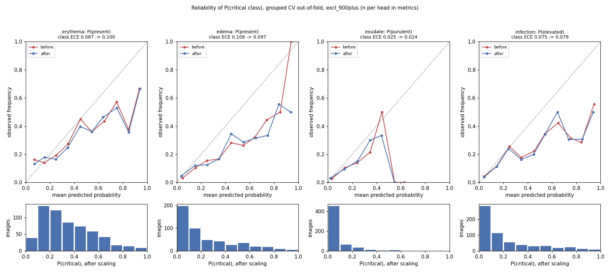

# IncisionIQ: explainable surgical wound assessment

A photo of a surgical incision plus four questions in, a three-level triage verdict out (On track / Watch / Review recommended), with the attributes behind it, a Grad-CAM, and a report that states only what the model predicted. Built as a portfolio project for remote post-operative infection monitoring, with the habits a regulated clinical product needs: patient-level splits, a confidence interval on every number, shortcut audits, and honest failure cases. **Not a medical device and not clinically validated.**

## Approach

- **Data:** SurgWound, 686 social-media wound photos with surgeon labels. The official split is image-level but not patient-level: same-patient photos cross train and test. Images are grouped by patient, and evaluation is **grouped 5-fold cross-validation** (pooled out-of-fold predictions) with **95% CIs from bootstrapping patient groups**. One source (image IDs 900+) holds 48% of High-risk cases and is identifiable from the photos, so **results excluding IDs 900+ (n = 613) are the primary estimate.** [Phase 1](results/phase1/REPORT.md)
- **Model:** ConvNeXt-Tiny with four heads (redness, swelling, drainage type, infection risk Low vs Elevated). It is trained on photos whose captions and stickers are removed by OCR and inpainting, the same step that runs on every incoming photo. [Phase 2](results/phase2/REPORT.md), [Phase 3](results/phase3/REPORT.md)
- **Decision:** infection risk is shown as a band with its observed rate, never as a probability. Bands come from a recall-targeted flag plus a referral band for uncertain cases. [Phase 4](results/phase4/REPORT.md)
- **Report:** a template filled from the predicted attributes only. Every claim is checked against the surgeon labels, and compared with Claude Opus 5.5 zero-shot. [Phase 5](results/phase5/REPORT.md)
- **Verdict:** explicit rules over the infection band and the patient's answers (pain 0 to 10, pain getting worse, fever, drainage). Demo: `streamlit run src/app/app.py`. **Every photo is scored by one model, CV fold 0**, chosen by a fixed rule (the first fold), not by performance, with the thresholds the cross-validation tested for that fold. A single model keeps the demo light enough for free CPU hosting, and its thresholds are ones that were actually evaluated. The four examples are fold 0 held-out images. [Phase 6](results/phase6/REPORT.md)

## Results (grouped CV, out-of-fold, excluding IDs 900+)

| | result |
|---|---|
| infection risk AUROC (Elevated) | 0.77 [0.71, 0.82] |
| redness / swelling / purulent drainage AUROC | 0.68 [0.63, 0.73] / 0.75 [0.68, 0.81] / 0.76 [0.67, 0.84] |
| Elevated images flagged or referred | **0.86 [0.78, 0.93]**, at 54.8 [50.3, 58.9] clinician reviews per 100 images (prevalence 14%) |
| observed Elevated rate in each band: low concern / uncertain / high concern | 4% [2, 7] / 12% [7, 17] / 29% [22, 36] (45% / 24% / 30% of images) |
| High-risk images in the low-concern band | 2 of 12 |
| purulent drainage recall | 0.10 [0.00, 0.21], so drainage comes from the patient's answer, not the photo |



**Calibration:** top-label ECE is 0.03 to 0.05, but high probabilities over-predict: a predicted 0.75 to 0.85 for infection corresponds to an observed rate of about 0.3. Temperature scaling did not help, so the app shows bands with observed rates instead of percentages. The recall target set on each fold's small inner-validation slice (0.8) was met out-of-fold only with the referral band (flag alone: 0.64 [0.54, 0.75]).

**Shortcut audit:** before mitigation, removing text overlays at test time lowered P(Elevated) by 0.043 [0.028, 0.061]. After retraining on inpainted photos, the effect is -0.006 [-0.014, +0.002], with no change in ranking. The image source stays identifiable from the photos themselves (probe AUROC 0.93), which is why the 900+ exclusion stays primary. Small corner logos and screenshot UI are not removed.

**Report faithfulness** (redness, swelling and infection risk claims vs surgeon labels):

| report | claims agreeing | claims contradicting |
|---|---|---|
| template from our model | 0.76 [0.73, 0.79] | 0.22 [0.19, 0.25] |
| Claude Opus 5.5, structured answers rendered by our template (B) | 0.69 [0.66, 0.72] | 0.29 [0.26, 0.31] |
| Claude Opus 5.5, free-text report (A) | 0.62 [0.60, 0.64] | 0.35 [0.33, 0.37] |

- **Free-text VLM reports over-call mild inflammation relative to surgeon grading, more than the same model's structured answers do. Grounded template reports stay consistent with the annotators' conventions.** Of A's 741 contradictions, 594 call mild redness or swelling present where surgeons said absent.
- **This is not a hallucination result.** A review of 38 contradictions found 25 threshold disagreements, 7 risk-level judgment calls, 2 missed findings, 4 checker errors and **0 clear hallucinations**. The review was done by Claude Code from the photos, not by a clinician.
- Template vs B is mostly supervised vs zero-shot: our model learned these annotators' thresholds.
- **The zero-shot VLM's perception is competitive.** It ties on infection risk (Elevated recall 0.65 vs 0.64 at a similar alert rate), catches 11 of 12 High-risk wounds against our 8, and is far better on purulent drainage (0.69 vs 0.10). It may have seen these public images in training.
- Both VLM conditions ran at effort "low" for budget, one run, $15.58. The free-text claim checker was validated on 30 hand-labeled reports (0.96 to 0.97 agreement on these attributes).

**Verdict** (no symptoms reported): On track covers 45% of images. **4% of On track images are surgeon-rated Elevated, and 2 of the 12 High-risk images are On track.** Fever, worsening pain, pain 7 or more and reported drainage raise the verdict, but **these symptom overrides cannot be tested on this dataset**, which has no patient answers. **The verdict is clinician-facing:** it decides which photos a care team reviews, and every verdict carries standing advice to contact the care team about fever, spreading redness, new drainage or worsening pain.

## Limitations

- **Small dataset:** 686 images, 23 High-risk, 30 purulent, so the rare-class intervals are wide.
- **Social-media photos, not home-app photos.** Selection bias toward cases people chose to post, and one source dominates the severe cases.
- **No serial photos of the same wound over time, so no trend tracking.** Real monitoring compares day 3 with day 5; this model judges single photos.
- **Labels depend on earlier MLLM judgments:** SurgWound gave a single annotator to images that three MLLMs all called Low risk.
- **The demo model saw 80% of the data:** fold 0 alone, not a model trained on all 686 images. Its band rates are pooled over all five folds.
- **Not clinically validated and not a medical device.** No outcome data, and the verdict thresholds are product choices.

## Next steps

1. **Photo quality gate:** blur, lighting, framing and "is this a wound" checks before any assessment (today only size and overlay coverage are checked).
2. **Longitudinal trend detection** on real serial photos from the same patients, which this dataset cannot support.
3. **Validation with clinicians:** prospective photos from the app, clinician-graded, with patient-reported symptoms and outcomes, so the overrides and thresholds can be tested.
4. **Hybrid reports:** VLM-extracted drainage fed into the grounded template, where the VLM is clearly stronger.

## Data handling

Patient photos stay local. The only exception was the agreed VLM baseline: inpainted, metadata-free JPEGs with opaque IDs, sent through the Anthropic Batches API, with the batches deleted afterwards. Caption text the OCR missed still reached the VLM in 8 of 686 images (post-operative day counts and similar, nothing identifying). Figures pixelate detected text. The VLM's transcriptions of that text are redacted in the stored outputs. Details: [Phase 5](results/phase5/REPORT.md), [pre-push audit](results/phase7/AUDIT.md). Deployment options: [Phase 7](results/phase7/DEPLOYMENT.md).

## Reproduce

```
python -m venv --system-site-packages .venv && .venv/Scripts/python -m pip install -r requirements.txt
.venv/Scripts/python scripts/phase1_audit.py    # downloads SurgWound on first run
```
Each phase report lists its scripts. Seeds are fixed, and every result comes from scripts, not notebooks.

## Data and citation

SurgWound: Xu et al., *SurgWound-Bench: a benchmark for surgical wound diagnosis*, npj Digital Medicine 2026, [doi:10.1038/s41746-026-02791-3](https://doi.org/10.1038/s41746-026-02791-3). Hugging Face `xuxuxuxuxu/SurgWound`, CC BY-SA 4.0. The demo examples and Grad-CAM figures are adapted from it under the same license.

## License

Code: [MIT](LICENSE). Dataset-derived content (the Grad-CAM figures, the demo examples, per-image outputs in `results/`, and any model weights if published) is CC BY-SA 4.0, with attribution to Xu et al. 2026.
